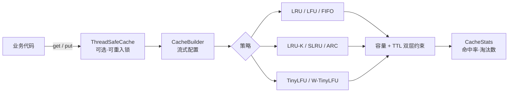

<div align="center">

# cobalt

### 零依赖的 Python 缓存工具包 —— 七种淘汰策略，同一套 API 可插拔切换

[](https://github.com/WsNodeX/cobalt/stargazers)
[](https://github.com/WsNodeX/cobalt/releases)
[](LICENSE)

</div>

---

缓存在后端系统里无处不在：数据库查询结果、RPC 响应、模板渲染、会话状态、限流计数。
但真正决定缓存**有效**的，是它满了之后**丢掉谁**。

- 只用 `dict`：内存无限增长，最终 OOM。
- 用错策略：热点集中的负载用 FIFO，会把正在被反复访问的数据踢掉；扫描型负载用纯
  LRU，一次全表遍历就冲垮整个缓存。
- 盲目上重依赖：你只是想要个可靠的本地缓存，却被迫引入带 C 扩展的一整套库。

`cobalt` 把业界验证过的淘汰算法用纯标准库实现出来，统一在同一套接口下——一行代码
切换策略，用数据说话地选型。

## 快速开始

```python
from cobalt import CacheBuilder

# 一行构建最常用的 LRU
cache = CacheBuilder().maximum_size(1000).build()
cache.put("user:42", {...})
cache.get("user:42")
print(cache.stats.hit_rate)      # 1.0 — stats 是属性，不是方法
```

```python
# 换成 W-TinyLFU，应对「扫描型 + 热点型」混合负载
cache = CacheBuilder().policy("wtinylfu").maximum_size(1000).build()

# 线程安全门面，Web 服务里可当 drop-in
from cobalt import ThreadSafeCache
safe = ThreadSafeCache(CacheBuilder().maximum_size(500).build())

# 装饰器风格：把缓存对象传进去
from cobalt import cached
@cached(CacheBuilder().maximum_size(256).build())
def expensive(n): ...
```

```bash
python -m cobalt.cli bench      # 同一倾斜负载下各策略的命中率对比
```

## 七种策略

`CacheBuilder().policy(...)` 接受这七个字符串：

| `policy=` | 策略 | 一句话 | 什么时候选它 |
|---|---|---|---|
| `"fifo"` | FIFO | 谁先来谁先走 | 数据无访问局部性，只要个有界队列 |
| `"lru"` | LRU | 踢最久没被访问的 | 通用默认，局部性友好 |
| `"lfu"` | LFU | 踢访问频率最低的 | 热点长期稳定 |
| `"lruk"` | LRU-K | 访问 K 次才算「热」 | 要抗扫描 |
| `"slru"` | SLRU | 冷热分段，冷段是缓冲区 | 想抑制一次性扫描污染 |
| `"arc"` | ARC | 按历史自适应调整冷热容量 | 负载形态会变 |
| `"wtinylfu"` | W-TinyLFU | 窗口 LRU + TinyLFU 主区 | 混合负载下的默认最优解 |

`TinyLfu` 也作为独立类导出，但它是 W-TinyLFU 的内部组件，不注册到 builder ——
直接 `from cobalt import TinyLfu` 实例化即可，不要写 `policy("tinylfu")`。

## 架构



`CacheBuilder` 按策略自动注入专属参数（`k`、`window_ratio`、`protected_ratio`），
所以换策略只需改一个字符串，不用动调用方的代码。

## API

| 名字 | 作用 |
|---|---|
| `CacheBuilder` | 流式配置：`.policy()` `.maximum_size()` `.expire_after()` `.thread_safe()` |
| `LRUCache` `LFUCache` `FIFOCache` `LRUKCache` `SLRUCache` `ARCCache` `WTinyLfuCache` | 七种策略的具体实现，接口一致 |
| `TinyLfu` | W-TinyLFU 的频率准入组件，可单独使用 |
| `BaseCache` | 所有策略的基类，自己写策略继承它 |
| `ThreadSafeCache` | 用可重入锁包裹任意缓存 |
| `cached` | 函数记忆化装饰器 |
| `CacheStats` | 命中率 / 未命中 / 写入 / 淘汰数 |
| `Clock` | 可注入时钟，测试里塞假时钟即可完全确定性，不依赖 `sleep` |

## 测试

```bash
python -m unittest discover -s tests
# Ran 71 tests — OK
```

覆盖八种策略的淘汰顺序、TTL 惰性清理、统计准确性、线程安全、装饰器与 CLI。

## 限制

- **纯 Python。** 单次操作比 C 扩展实现慢一个量级；它买的是可读性和零部署负担。
- **单机内存。** 没有分布式缓存、没有持久化，重启即清空。
- **LRU-K / ARC / W-TinyLFU 的参数字典值得读。** 默认值适通用负载，但调优需要理解算法。

缓存淘汰策略的选择思路写在 [docs/cache-eviction-policies.md](docs/cache-eviction-policies.md)。

## 许可证

MIT
